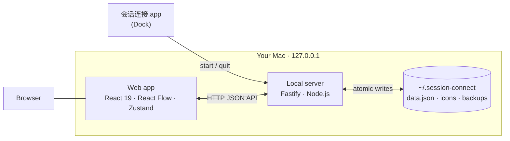

<div align="center">


# Session Connect · 会话连接

**Lay out your scattered Claude Code and Codex sessions on one infinite canvas.**

Each session is a card; each arrow shows which way messages are forwarded. See at a glance which sessions a feature has, how far each one has gone, and who gets the next message.

[](LICENSE)


[简体中文](README.md) · English


</div>

> The app's interface is in Simplified Chinese only.

## Why

When you build features with several AI agents following a "plan → review → build → cross-review → accept" workflow, one feature easily spans many sessions across Claude Code and Codex — a planning session, a dev session, review sessions — with messages forwarded back and forth. Before long you lose track of which session owns what, which review round you're on, and where the next message should go.

**Session Connect** is a small website that runs only on your Mac: one canvas per feature, one card per session, and the forwarding relationships are the arrows. When a session is in progress, its arrows animate in the direction of flow.

## ✨ Features

- 🗂 **Multiple canvases** — create, rename, delete, switch; each canvas remembers its own pan and zoom, and you come back to the last one you opened.
- 🧭 **Infinite canvas** — pan, zoom (10%–200%), fit view, minimap, dotted background, native trackpad gestures.
- 🃏 **Session cards** — icon, name, note and four statuses (todo / in progress / done / blocked); create by click, drag-and-drop or right-click; multi-select, bulk status change, duplicate.
- ➰ **Arrows that flow** — drag from a handle to connect; forward / backward / both directions; optional labels; arrows turn into animated pink dashes while either end is in progress.
- 🎨 **Icon library** — built-in Claude, Codex, Antigravity, DeepSeek and WorkBuddy icons, plus your own PNG / JPG / WebP / SVG uploads (≤ 1 MB, de-duplicated).
- ↩️ **Undo / redo** — 100 steps of history per canvas; a drag or a bulk edit counts as one step.
- 💾 **Autosave that survives failure** — changes hit the disk within a second; automatic retry when offline or the disk is full; a backup on every start (last 10 kept) and automatic recovery from a corrupted data file.
- 🪟 **Safe across tabs** — two tabs editing the same canvas never silently overwrite each other; conflicts are reported with a one-click reload.
- 📦 **Export / import** — one JSON file carries every canvas and uploaded icon; import only appends, never overwrites.
- 🍎 **Native macOS app** — one command builds `会话连接.app`; put it in the Dock, click to start the server and open the browser, quit to stop.
- 🔒 **Local only** — listens on `127.0.0.1` only. No login, no cloud, no telemetry; your data is a folder in your home directory.

<div align="center">

<sub>Select a card to edit its icon, name, note and status, and manage all of its arrows</sub>
</div>

## 🚀 Getting started

**Requirements:** macOS · Node.js `^20.19` / `^22.12` / `≥ 24` · a modern browser (Chrome recommended)

```bash
git clone https://github.com/LiuNan520/session-connect.git
cd session-connect
npm install
npm run app
```

`npm run app` builds the web app and creates `/Applications/会话连接.app`. Drag it to the Dock and you're done.

> Just want to try it? Run `npm start` — it starts the server in your terminal and opens the browser; press `Ctrl+C` to stop.

> After moving the project folder or updating the code, run `npm run app` again. For front-end-only changes, `npm run build` and a page refresh are enough.

## ⌨️ Cheat sheet

| Action | Effect |
| --- | --- |
| `⌘Z` / `⌘⇧Z` | Undo / redo |
| `Delete` / `Backspace` | Delete selected cards or arrows |
| `⌘A` | Select all cards on the canvas |
| `Esc` | Close dialog or menu → blur input → close panel and clear selection |
| Two-finger swipe / wheel / drag empty space | Pan |
| Pinch / `⌘` + wheel | Zoom |
| `Shift` + drag empty space | Box-select cards |
| `Shift` + click a card | Add to / remove from selection |
| Drag from a card's handle onto another card | Create an arrow (becomes two-way if the reverse already exists) |
| Right-click empty space / card / arrow | Context menu: new card, duplicate, delete… |

## 🔐 Data & privacy

Everything stays on your Mac, in `~/.session-connect/` by default:

```text
~/.session-connect/
├── data.json      # all canvases, cards, arrows and preferences
├── icons/         # uploaded icons
├── backups/       # automatic backups on start, last 10 kept
└── logs/          # server logs (card contents are never logged)
```

- The server listens on `127.0.0.1` only and validates `Host` / `Origin`, so neither other devices on your network nor other websites can reach it.
- Writes go to a temporary file first and are atomically renamed into place, so a crash never leaves a half-written file.
- Set `SESSION_CONNECT_HOME=/absolute/path` to use a different data directory (handy for testing).

## 🏗 Architecture



| Layer | Stack |
| --- | --- |
| Web app | React 19, [React Flow](https://reactflow.dev) (`@xyflow/react`), Zustand, Vite |
| Local server | Node.js, Fastify, sharp (icon validation and decoding) |
| Shared | TypeScript types, limits, grapheme-aware text rules (`shared/`) |
| App shell | AppleScript applet + shell launcher, with a single-instance lock |
| Tests | Vitest: unit and API tests |

## 📁 Project layout

```text
session-connect/
├── web/src/          # front end: components, store, save queue and other pure logic
├── server/src/       # local server: API, storage, backups, import/export, single instance
├── shared/           # types and rules shared by both sides
├── scripts/          # macOS app builder, launcher, fixtures
├── assets/           # app icon, built-in icons, README screenshots
├── fixtures/         # performance fixture: 200 cards / 300 arrows
└── docs/             # PRD, technical design, API reference, acceptance checklist (Chinese)
```

## 🛠 Development

```bash
npm run dev        # Vite + server in watch mode (quit the running app first)
npm run typecheck  # type-check shared, server and web
npm test           # Vitest unit and API tests
npm run build      # build dist/web and dist/server
npm run fixture    # generate fixtures/perf-200.json
```

Full requirements, design and API contract (in Chinese):

- [PRD](docs/prd/会话连接-PRD.md) — every interaction, every message, 48 acceptance criteria
- [Technical design](docs/方案/会话连接-技术方案.md) — trade-offs, delivery notes and code-review records
- [API reference](docs/接口.md) — HTTP endpoints, data types, save and retry rules

> This project was built with the very workflow it serves: Claude wrote the PRD and design, GPT reviewed them; GPT built the back end, Claude built the front end; each reviewed the other's code; and a human signed off against the acceptance criteria.

## 🗺 Roadmap

- [ ] Search cards and jump to them
- [ ] Group frames
- [ ] Drag from a handle into empty space to create a connected card
- [ ] Reorder and duplicate canvases
- [ ] Alignment and auto-layout
- [ ] Launch at login
- [ ] Reuse the open browser tab when clicking the app icon
- [ ] Streaming import/export for very large data files

## ⚠️ Known limitations

- macOS only; the interface is Chinese only.
- Import, export and backup currently handle the whole JSON as one string and are bound by V8's maximum string length (~512 MB) — roughly 400 uploaded 1 MB icons before you hit it. See the [API reference](docs/接口.md).
- Undo history lives in the current page and is cleared on refresh; deleting a canvas or icon, and importing, cannot be undone.

## 🙏 Acknowledgements

- [React Flow](https://reactflow.dev), [Fastify](https://fastify.dev), [Zustand](https://zustand.docs.pmnd.rs), [Vite](https://vite.dev), [sharp](https://sharp.pixelplumbing.com) and the rest of the open-source ecosystem.
- Claude, Codex, Antigravity and DeepSeek icons from [LobeHub Icons](https://github.com/lobehub/lobe-icons) (MIT); the WorkBuddy icon from the [WorkBuddy website](https://www.workbuddy.ai/). All trademarks belong to their respective owners.
- The pigeon in the app icon is [Pigeon](https://openclipart.org/detail/71287/pigeon-by-wildchief) by wildchief on Openclipart (public domain).

## 📄 License

[MIT](LICENSE) © 2026 Liu Nan
