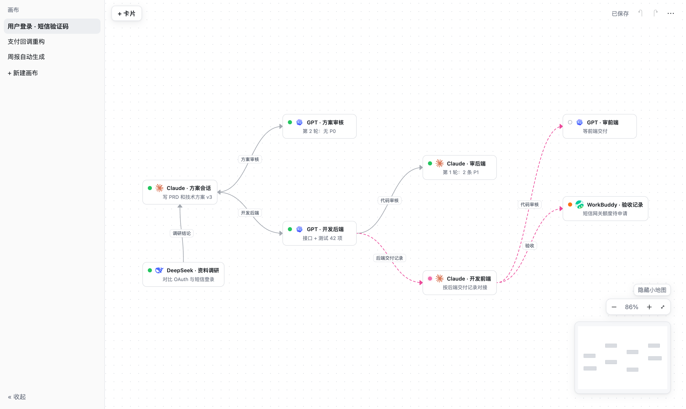
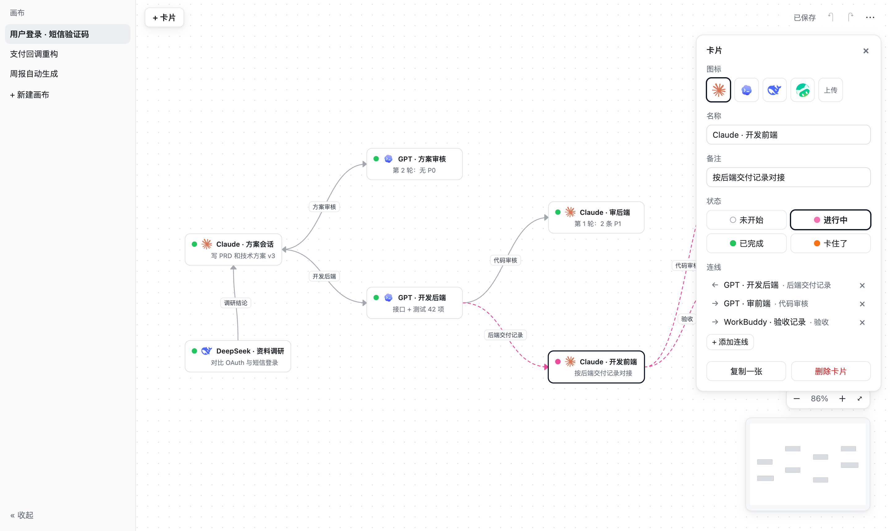
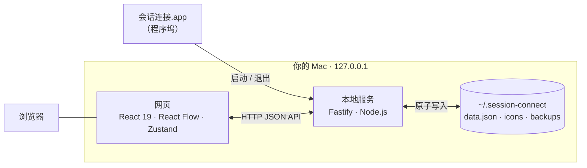

<div align="center">


# 会话连接 · Session Connect

**把散落在 Claude Code、Codex 里的 AI 会话，放到一张无限画布上。**

用卡片代表会话，用带箭头的连线表示消息往哪边转发——一眼看清每个功能开了哪些会话、走到了哪一步、下一步该发给谁。

[](LICENSE)


简体中文 · [English](README.en.md)



</div>

## 为什么做它

按「方案 → 审核 → 开发 → 互审 → 验收」的流程和多个 AI 协作时，一个功能往往要在 Claude Code 和 Codex 之间开好几个会话：方案会话、开发会话、审核会话……消息还要来回转发。会话一多，就分不清哪个会话负责什么、审到第几轮、下一步该发给谁。

**会话连接**是一个只跑在你本机上的小网站：一个功能一张画布，一个会话一张卡片，转发关系就是连线。正在进行的会话，连线会沿着箭头方向流动起来。

## ✨ 特性

- 🗂 **多画布**：新建、重命名、删除、切换；每张画布记住自己的平移位置和缩放，重新打开回到上次的画布。
- 🧭 **无限画布**：平移、缩放（10%–200%）、「适应全部」、小地图、点阵背景，触控板手势原生支持。
- 🃏 **会话卡片**：图标 + 名称 + 备注 + 四种状态（未开始 / 进行中 / 已完成 / 卡住了）；点击、拖放、右键都能新建，支持多选、批量改状态、复制。
- ➰ **会自己流动的连线**：从连接点拖出即连，单向 / 反向 / 双向可切换，可加文字标签；任一端卡片“进行中”时，连线变成粉色虚线沿箭头流动。
- 🎨 **图标库**：内置 Claude、Codex、DeepSeek、WorkBuddy 图标，也能上传 PNG / JPG / WebP / SVG（≤ 1 MB，自动去重）。
- ↩️ **撤销 / 重做**：每张画布独立的 100 步历史，拖动、批量修改都按一步算。
- 💾 **自动保存，不怕出错**：改动 1 秒内落盘；断线、磁盘满自动重试；每次启动自动备份（保留 10 份），数据文件损坏时从备份恢复。
- 🪟 **多标签页安全**：两个标签页改同一张画布不会互相覆盖，冲突时明确提示并可一键重新加载。
- 📦 **导出 / 导入**：一个 JSON 文件带走全部画布和上传的图标，导入只追加、不覆盖。
- 🍎 **原生 macOS 应用**：一条命令生成「会话连接.app」，放进程序坞，点一下就启动服务并打开浏览器，退出即停止。
- 🔒 **纯本地**：服务只监听 `127.0.0.1`，无登录、无云端、无遥测，数据就是你家目录里的一个文件夹。

<div align="center">

<sub>选中卡片即可在右侧面板改图标、名称、备注、状态，管理它的所有连线</sub>
</div>

## 🚀 快速开始

**环境要求**：macOS · Node.js `^20.19` / `^22.12` / `≥ 24` · 一个现代浏览器（推荐 Chrome）

```bash
git clone https://github.com/LiuNan520/session-connect.git
cd session-connect
npm install
npm run app
```

`npm run app` 会构建网页并生成 `/Applications/会话连接.app`。把它拖到程序坞，以后点一下就能用。

> 只想先试试？运行 `npm start`，会在终端里启动服务并自动打开浏览器，按 `Ctrl+C` 停止。

> 移动项目目录、或更新代码后，重新运行一次 `npm run app`；只改了前端时 `npm run build` 后刷新页面即可。

## ⌨️ 操作速查

| 操作 | 作用 |
| --- | --- |
| `⌘Z` / `⌘⇧Z` | 撤销 / 重做 |
| `Delete` / `Backspace` | 删除选中的卡片或连线 |
| `⌘A` | 选中当前画布所有卡片 |
| `Esc` | 关闭弹窗或菜单 → 输入框失焦 → 关闭面板并取消选中 |
| 双指滑动 / 滚轮 / 拖动空白处 | 平移画布 |
| 双指捏合 / `⌘` + 滚轮 | 缩放画布 |
| `Shift` + 拖动空白处 | 框选卡片 |
| `Shift` + 单击卡片 | 加选或取消选中 |
| 从卡片连接点拖到另一张卡片 | 创建连线（已有反向连线时自动变成双向） |
| 右键空白处 / 卡片 / 连线 | 新建卡片、复制、删除等快捷菜单 |

## 🔐 数据与隐私

所有数据都在本机，默认位于 `~/.session-connect/`：

```text
~/.session-connect/
├── data.json      # 全部画布、卡片、连线和偏好设置
├── icons/         # 上传的图标
├── backups/       # 启动时自动备份，保留最近 10 份
└── logs/          # 服务日志（不记录卡片内容）
```

- 服务只监听 `127.0.0.1`，并校验 `Host` / `Origin`，局域网里的其他设备和其他网站都访问不到。
- 写盘采用“先写临时文件再原子替换”，崩溃不会留下半截文件。
- 设置环境变量 `SESSION_CONNECT_HOME=/绝对路径` 可以换一个数据目录，适合测试。

## 🏗 架构



| 层 | 技术 |
| --- | --- |
| 网页 | React 19、[React Flow](https://reactflow.dev)（`@xyflow/react`）、Zustand、Vite |
| 本地服务 | Node.js、Fastify、sharp（图标校验与解码） |
| 共享 | TypeScript 类型、上限常量、字素计数等文字规则（`shared/`） |
| 应用外壳 | AppleScript applet + shell 启动脚本，单实例锁保证只有一个服务 |
| 测试 | Vitest：单元测试 + 接口测试 |

## 📁 项目结构

```text
session-connect/
├── web/src/          # 前端：组件、Store、保存队列等纯逻辑
├── server/src/       # 本地服务：接口、存储、备份、导入导出、单实例
├── shared/           # 前后端共用的类型和规则
├── scripts/          # 生成 macOS 应用、启动脚本、测试夹具
├── assets/           # 应用图标、内置图标、README 截图
├── fixtures/         # 200 张卡片 / 300 条连线的性能夹具
└── docs/             # PRD、技术方案、接口文档、验收清单
```

## 🛠 开发

```bash
npm run dev        # Vite + 后端 watch（先退出已运行的应用）
npm run typecheck  # TypeScript 类型检查（shared、server、web）
npm test           # Vitest 单元和接口测试
npm run build      # 构建 dist/web 和 dist/server
npm run fixture    # 生成 fixtures/perf-200.json
```

完整的需求、设计和接口约定：

- [PRD](docs/prd/会话连接-PRD.md) —— 每个交互、文案和 48 条验收标准
- [技术方案](docs/方案/会话连接-技术方案.md) —— 设计取舍、交付记录和代码审核记录
- [接口文档](docs/接口.md) —— HTTP 接口、数据类型、保存与重试规则

> 这个项目本身就是用它所服务的工作流做出来的：Claude 写 PRD 和方案、GPT 审核，GPT 写后端、Claude 写前端，再互相审代码，最后人工按验收标准验收。

## 🗺 路线图

- [ ] 搜索卡片并定位
- [ ] 分组框
- [ ] 从连接点拖到空白处，直接新建卡片并连上
- [ ] 画布排序、复制画布
- [ ] 对齐、自动布局
- [ ] 开机自动启动
- [ ] 点应用图标时复用已打开的标签页
- [ ] 流式导入导出，支持超大数据文件

## ⚠️ 已知限制

- 仅支持 macOS；界面只有中文。
- 导入、导出和备份目前把整份 JSON 当作一个字符串处理，受 V8 单字符串上限（约 512 MB）限制——大约要上传 400 个 1 MB 的图标才会碰到。详见[接口文档](docs/接口.md)。
- 撤销历史只在当前页面里，刷新后清空；删除画布、删除图标、导入不能撤销。

## 🙏 致谢

- [React Flow](https://reactflow.dev)、[Fastify](https://fastify.dev)、[Zustand](https://zustand.docs.pmnd.rs)、[Vite](https://vite.dev)、[sharp](https://sharp.pixelplumbing.com) 等优秀的开源项目。
- Claude、Codex、DeepSeek 图标来自 [LobeHub Icons](https://github.com/lobehub/lobe-icons)（MIT）；WorkBuddy 图标来自 [WorkBuddy 官网](https://www.workbuddy.ai/)。各图标商标归各自所有者。
- 应用图标中的鸽子来自 Openclipart 上 wildchief 的 [Pigeon](https://openclipart.org/detail/71287/pigeon-by-wildchief)（公有领域）。

## 📄 许可证

[MIT](LICENSE) © 2026 Liu Nan
